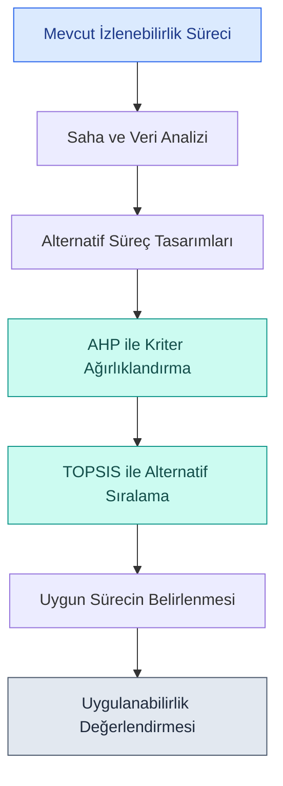

# Triko Üretiminde Dijital İzlenebilirlik

### Dijital Ürün Pasaportuna Hazırlık Kapsamında AHP ve TOPSIS ile Süreç Tasarımı

**İstanbul Gelişim Üniversitesi | Endüstri Mühendisliği**

**2026–2027 | Lisans Bitirme Projesi**

---

## Proje Hakkında

Bu proje, bir triko üretim işletmesinde Dijital Ürün Pasaportuna (DÜP) hazırlık kapsamında izlenebilirlik sürecinin tasarlanmasını amaçlamaktadır.

Çalışmada mevcut QR kod tabanlı çuval takibi ve üretim kayıtları incelenerek, çuvaldan bitmiş ürüne kadar veri sürekliliğini destekleyecek alternatif süreç tasarımlarının geliştirilmesi hedeflenmektedir.

Alternatiflerin değerlendirilmesinde **AHP (Analitik Hiyerarşi Prosesi)** ve **TOPSIS** yöntemlerinin birlikte kullanılması planlanmaktadır.

> **Projenin temel yaklaşımı:** Yeni bir yazılım geliştirmek yerine, mevcut işletme altyapısıyla uygulanabilecek bir izlenebilirlik süreci tasarlamak.

---

## Problem Tanımı

İncelenen işletmede üretimden konfeksiyona gönderilen çuvallar QR kodlarla tanımlanmaktadır.

Bununla birlikte, üretim ve konfeksiyon süreçlerindeki kayıtların bitmiş ürünle ilişkilendirilmesi açısından geliştirilmesi gereken alanlar bulunmaktadır.

Ön bilgilere dayalı, saha doğrulaması bekleyen başlıca araştırma alanları:

- Çuval ile bitmiş ürün arasındaki veri bağlantısının sınırlı olması
- Üretim kayıtlarında eksik veri bulunabilmesi
- Fire bilgilerinin kayıt düzeninin incelenmesi
- Süreçler arasında kayıt sürekliliğinin sağlanması ihtiyacı
- İzlenebilirlik kapsamının mevcut altyapıyla geliştirilmesi

Bu sorunlar saha verileriyle ayrıntılı olarak doğrulanacaktır.

---

## Araştırma Yaklaşımı

*Bu diyagram araştırmanın planlanan yöntemsel akışını göstermektedir. AHP–TOPSIS hesaplamaları henüz gerçekleştirilmemiştir.*

---

## Proje Dokümantasyonu

| Bölüm | Açıklama |
|---|---|
| [Proje Dokümantasyonu](docs/README.md) | Problem tanımı, araştırma amacı ve kapsam |
| [Proje Durumu](docs/proje-durumu.md) | Tamamlanan çalışmalar, açık işler ve sonraki adımlar |
| [Veri ve Paylaşım İlkeleri](docs/veri-paylasim-ilkeleri.md) | Gizlilik, örnek veri ve yayımlama sınırları |
| [Literatür Araştırması](literatur/README.md) | Araştırma alanları ve literatür değerlendirmesi |
| [Akademik Kaynakça](literatur/kaynakca.md) | Ara raporda kullanılan 9 kaynak |
| [Mevcut Üretim Süreci](mevcut-surec/README.md) | QR kod tabanlı izlenebilirliğin ön incelemesi |
| [Süreç Akış Şeması](mevcut-surec/surec-akis-semasi.md) | Kavramsal üretim süreci gösterimi |
| [AHP ve TOPSIS](ahp-topsis/README.md) | Çok kriterli karar verme yaklaşımı |
| [Süreç Tasarımı](onerilen-surec/README.md) | Alternatif izlenebilirlik süreçleri |
| [Görseller ve Diyagramlar](gorseller/README.md) | Proje şemaları ve veri akış gösterimleri |

---

## Kullanılan Yöntemler

### AHP — Analitik Hiyerarşi Prosesi

Değerlendirme kriterlerinin göreli önem düzeylerini belirlemek amacıyla kullanılacaktır.

Planlanan kriterler arasında veri erişilebilirliği, uygulama maliyeti, hata riski, personel iş yükü ve izlenebilirlik kapsamı bulunmaktadır.

### TOPSIS — İdeal Çözüme Benzerliğe Göre Sıralama

Alternatif izlenebilirlik süreçlerinin, AHP ile elde edilen kriter ağırlıkları kullanılarak karşılaştırılması ve sıralanması planlanmaktadır.

---

## Proje İlerleme Durumu

| Çalışma | Durum |
|---|---|
| Proje konusunun belirlenmesi | Tamamlandı |
| Problem, amaç ve kapsamın tanımlanması | Tamamlandı |
| Literatür araştırması | Tamamlandı |
| Ara rapor taslağının hazırlanması | Tamamlandı |
| Danışman değerlendirmesi | Bekleniyor |
| Ara rapor son biçim, PDF ve imza kontrolleri | Açık |
| Ara rapor teslimi | Bekleniyor |
| Saha verilerinin doğrulanması | Planlandı |
| Alternatif süreçlerin kesinleştirilmesi | Planlandı |
| AHP kriter ağırlıklarının hesaplanması | Planlandı |
| TOPSIS değerlendirmesi | Planlandı |
| Önerilen sürecin değerlendirilmesi | Planlandı |

---

## Beklenen Katkılar

Projenin tamamlanmasıyla:

- Mevcut izlenebilirlik sürecindeki eksikliklerin belirlenmesi
- Üretim ve konfeksiyon kayıtları arasındaki ilişkilerin açıklanması
- İşletme koşullarına uygun alternatif süreçlerin değerlendirilmesi
- Çok kriterli karar verme yöntemleriyle süreç seçiminin desteklenmesi
- Dijital Ürün Pasaportuna hazırlık açısından geliştirilebilecek alanların ortaya konulması

hedeflenmektedir.

Bu çıktılar henüz tamamlanmış araştırma sonuçları değildir.

---

## Akademik Bilgiler

**Proje:** Bir Triko İşletmesinde Dijital Ürün Pasaportuna Hazırlık Kapsamında İzlenebilirlik Sürecinin AHP ve TOPSIS Yöntemleriyle Tasarlanması

**Üniversite:** İstanbul Gelişim Üniversitesi

**Bölüm:** Endüstri Mühendisliği

**Proje türü:** Lisans Bitirme Projesi

**Akademik dönem:** 2026–2027

---

## Gizlilik ve Kullanım

Bu depo akademik çalışmanın yöntemini, kapsamını ve paylaşılabilir dokümantasyonunu sunmaktadır.

İşletmeye ait gizli üretim verileri, müşteri bilgileri ve ticari kayıtlar yayımlanmayacaktır.

Proje devam etmektedir. Saha analizleri ve karar verme sonuçları, tamamlandıkça ve gerekli paylaşım izinleri alındıkça güncellenecektir.

Ayrıntılar: [Veri ve Paylaşım İlkeleri](docs/veri-paylasim-ilkeleri.md) · [Telif ve Kullanım](TELIF.md).

Bu depo için açık kaynak lisansı verilmemiştir. Üçüncü taraf kaynakların hakları kendi hak sahiplerine aittir.
