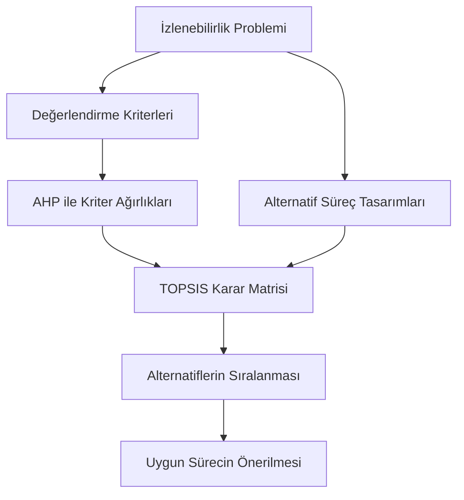

# AHP ve TOPSIS ile Çok Kriterli Karar Verme

## 1. Genel Bakış

Bu bölüm, triko üretiminde izlenebilirlik
süreci alternatiflerinin değerlendirilmesinde
kullanılması planlanan çok kriterli karar
verme yaklaşımını açıklamaktadır.

Araştırmada iki yöntem birlikte kullanılacaktır:

- AHP (Analitik Hiyerarşi Prosesi)
- TOPSIS (İdeal Çözüme Benzerliğe Göre
  Tercih Sıralama Tekniği)

AHP kriter ağırlıklarının belirlenmesinde,
TOPSIS ise alternatif süreçlerin
sıralanmasında kullanılacaktır.

## 2. Araştırmanın Karar Problemi

İşletmenin mevcut QR ve ERP altyapısı
dikkate alınarak farklı izlenebilirlik
süreçleri geliştirilecektir.

Bu alternatifler, yalnızca teknik
özellikleriyle değil; maliyet, veri
erişilebilirliği, uygulanabilirlik ve
operasyonel etkiler açısından da
değerlendirilecektir.

## 3. AHP Yöntemi

AHP, kriterlerin ikili karşılaştırmalar
yoluyla göreli önem düzeylerini
belirlemeye yönelik bir yöntemdir.

Planlanan uygulama adımları:

1. Değerlendirme kriterlerini belirlemek
2. İlgili çalışanların uzman görüşlerini almak
3. İkili karşılaştırma matrisini oluşturmak
4. Kriter ağırlıklarını hesaplamak
5. Tutarlılık oranını kontrol etmek

### Aday Değerlendirme Kriterleri

- Veri erişilebilirliği
- Uygulama maliyeti
- Uygulama kolaylığı
- Kayıt hatası riski
- İşlem süresi
- Personel iş yükü
- İzlenebilirlik kapsamı

Bu kriterler ön değerlendirme
niteliğindedir. Kesin kriter listesi
saha çalışmasının ardından
belirlenecektir.

## 4. TOPSIS Yöntemi

TOPSIS, alternatiflerin ideal ve
negatif ideal çözümlere uzaklıklarını
dikkate alarak sıralanmasını sağlar.

Planlanan uygulama adımları:

1. Alternatif izlenebilirlik süreçlerini belirlemek
2. Karar matrisini oluşturmak
3. Karar matrisini normalize etmek
4. AHP ağırlıklarını matrise uygulamak
5. İdeal ve negatif ideal çözümleri belirlemek
6. Alternatiflerin uzaklıklarını hesaplamak
7. Yakınlık katsayılarını hesaplamak
8. Alternatifleri sıralamak

## 5. Yöntemlerin Birlikte Kullanımı

## 6. Çalışmanın Durumu

- [x] AHP ve TOPSIS yöntemleri araştırıldı
- [x] Yöntemlerin projedeki kullanım amaçları belirlendi
- [x] Ön değerlendirme kriterleri tanımlandı
- [ ] Uzman görüşlerinin alınması
- [ ] AHP ikili karşılaştırma matrisleri
- [ ] Kriter ağırlıklarının hesaplanması
- [ ] TOPSIS karar matrisi
- [ ] Alternatiflerin sıralanması
- [ ] Sonuçların değerlendirilmesi

## 7. Önemli Açıklama

Bu doküman, araştırmada uygulanacak
yöntemlerin planını göstermektedir.

Henüz gerçek saha verileriyle AHP veya
TOPSIS hesaplamaları yapılmamıştır.
Sonuçlar, analizler tamamlandıktan
sonra yayımlanacaktır.
