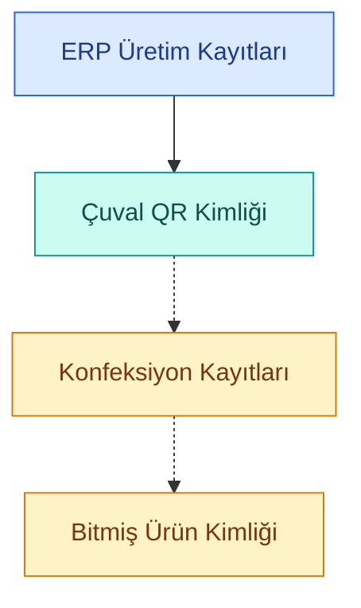

# İzlenebilirlik Veri İlişkileri

Bu diyagram, triko üretiminde mevcut kayıtların
incelenmesi ve geliştirilmesi gereken veri
bağlantılarının belirlenmesi amacıyla
hazırlanmış kavramsal bir modeldir.

## Diyagramın Açıklaması

**ERP üretim kayıtları:**
Üretim bilgilerinin takip edildiği mevcut
sistem kayıtlarını temsil eder.

**Çuval QR kimliği:**
Üretimden konfeksiyona gönderilen çuvalların
tanımlanmasında kullanılan mevcut yapıdır.

**Konfeksiyon kayıtları:**
Çuval içerisindeki parçaların sonraki
işlemlerle ilişkilendirilmesinde
incelenecek veri alanlarını temsil eder.

**Bitmiş ürün kimliği:**
Bitmiş ürün ile kaynak çuval ya da çuvallar
arasında kurulması hedeflenen ilişkiyi
temsil eder.

## Gösterim

- Düz oklar: Ön bilgilerden hareketle
  incelenecek mevcut kayıt ilişkisi.
- Kesikli oklar: Saha çalışması sırasında
  doğrulanması ve geliştirilmesi gereken
  veri bağlantıları.

**Not:** Diyagram gerçek veri tabanı
mimarisini veya tamamlanmış bir
entegrasyonu göstermemektedir.
