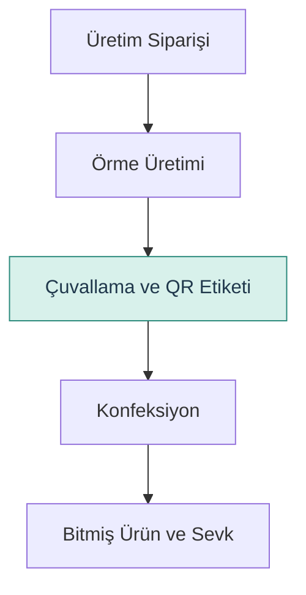

# Ön Süreç Akış Şeması

Bu şema, triko işletmesinin üretim ve izlenebilirlik sürecine ilişkin mevcut bilgilerden hazırlanmış kavramsal bir gösterimdir.

## Açıklama

- Üretim siparişinin ardından örme işlemleri gerçekleştirilir.
- Üretilen parçalar çuvallanarak QR etiketiyle tanımlanır.
- Çuvallar konfeksiyon işlemlerine gönderilir.
- Konfeksiyon sürecinin ardından bitmiş ürünler hazırlanır ve sevk edilir.

**Önemli not:** Bu diyagram, doğrulanmış mevcut durum süreç haritası değildir. Gerçek kayıt akışı, QR okutma noktaları ve çuval–bitmiş ürün ilişkileri saha çalışmasında doğrulanacaktır.
